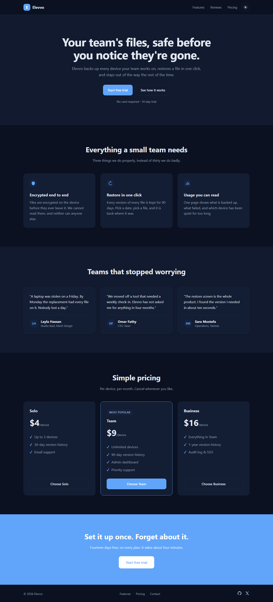
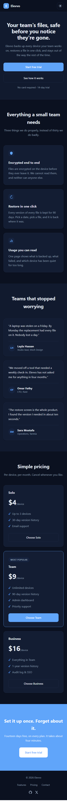
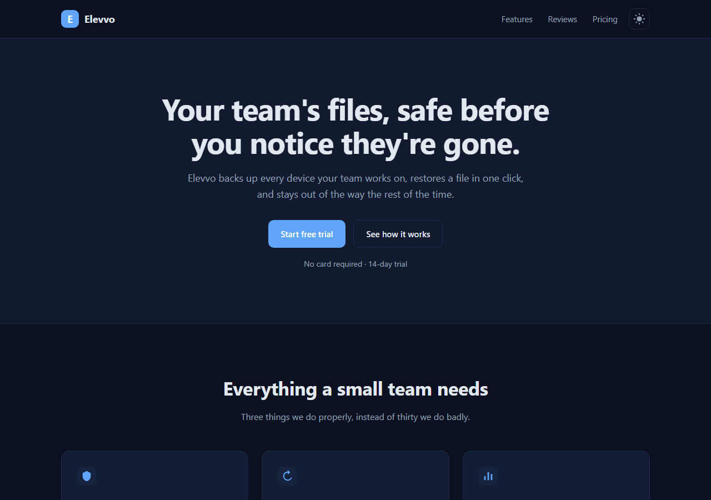

# Task 5 — Responsive Landing Page

A marketing landing page for a fictional backup product for small teams, built
with plain HTML, CSS and JavaScript, as part of the Elevvo Front-End Web
Development internship. The product is branded Elevvo so that it matches the
dashboard in Task 1, which uses the same logo.

## Screenshots







## Sections

The order follows the questions a visitor asks, in the order they ask them:

| Section | The question it answers |
| --- | --- |
| Hero | What is this, and why should I care? |
| Features | What does it actually do? |
| Testimonials | Has anyone else trusted it? |
| Pricing | What does it cost me? |
| Call to action | What do I do now? |
| Footer | Who are you, and where else can I find you? |

## Responsive at three widths

| Width | Layout |
| --- | --- |
| Above 900px | three columns, full navigation |
| 900px and below | two columns, the header navigation is dropped |
| 640px and below | one column, the hero buttons go full width and stack |

## Dark mode

Every colour is a CSS custom property declared once on `:root`, and the dark
theme is one block that redeclares the same names:

```css
[data-theme="dark"] {
    --bg: #0b1120;
    --text: #e2e8f0;
    /* ... */
}
```

So the JavaScript never touches a colour. It sets one attribute, and the whole
page follows:

```js
document.documentElement.dataset.theme = theme;
```

The choice is kept in `localStorage`, and the first visit starts from whatever
the visitor's own device is already set to.

## Details worth pointing at

- The pricing cards list a different number of features, but their buttons line
  up, because each card is a flex column and the button takes `margin-top: auto`
- The icon-only theme button carries an `aria-label` that says where the next
  click goes, and it changes with the theme
- The header links are plain `#section` anchors, so the page navigates with no
  JavaScript at all

## Built with

- HTML5 — semantic `header`, `main`, `section`, `article`, `figure` and `footer`
- CSS3 — custom properties, Grid, Flexbox, two media queries
- JavaScript — no libraries
- Icons — inline SVG, so there is nothing to download

## Running it

Open `index.html` in a browser. There is nothing to install or build.